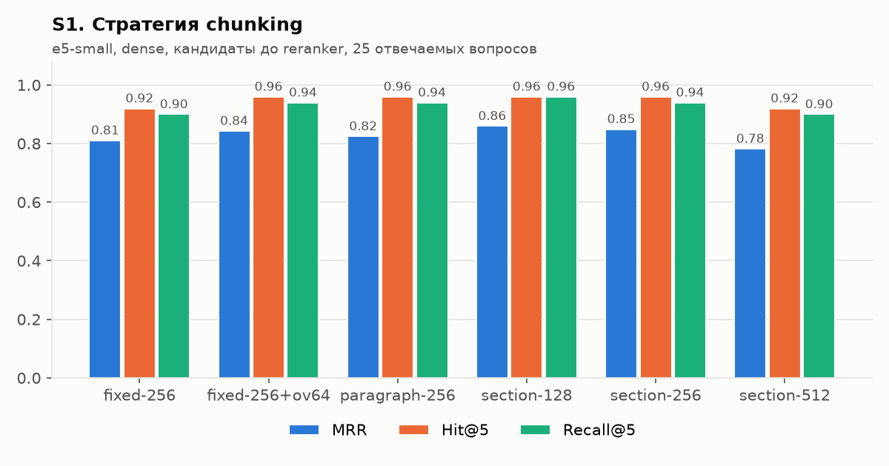
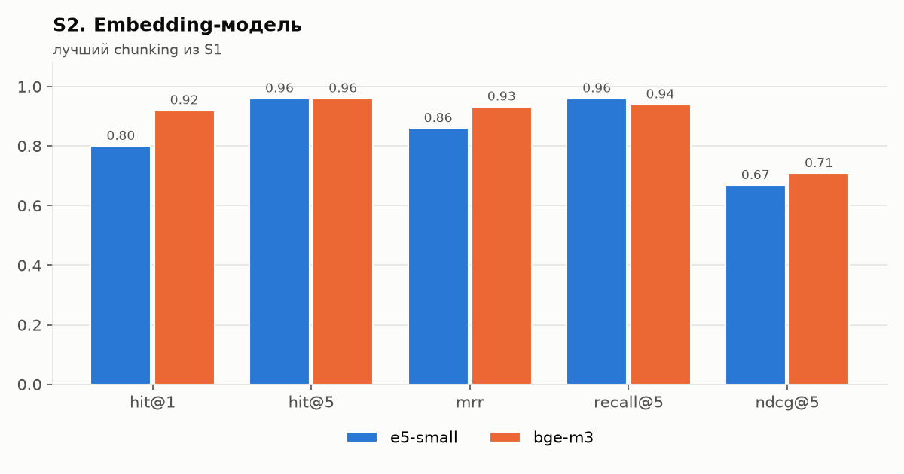
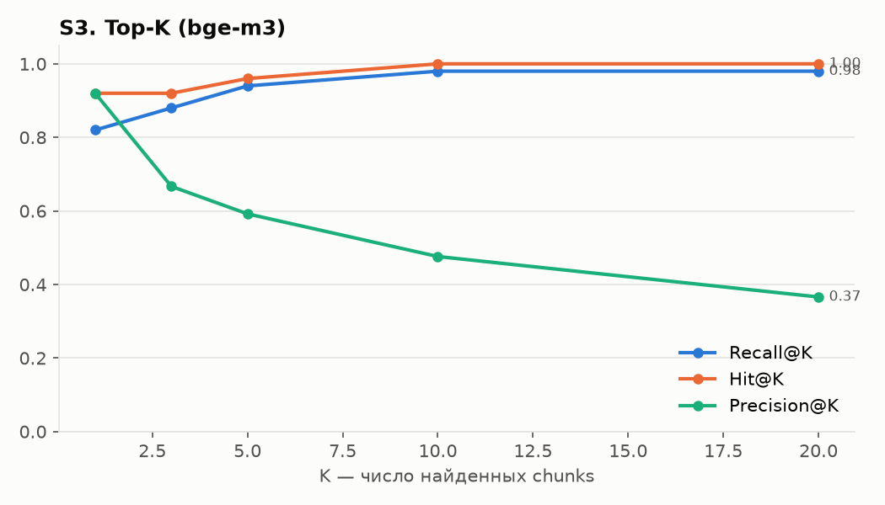
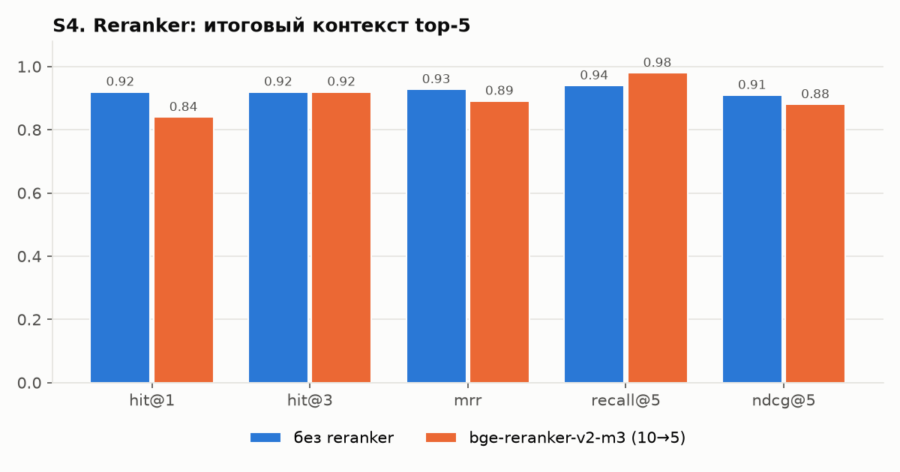
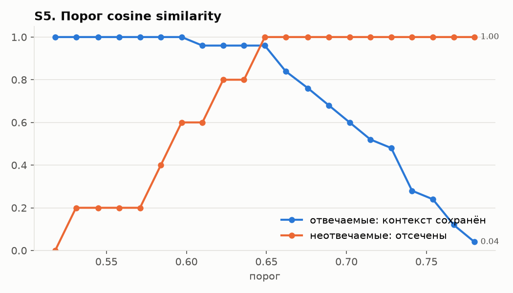
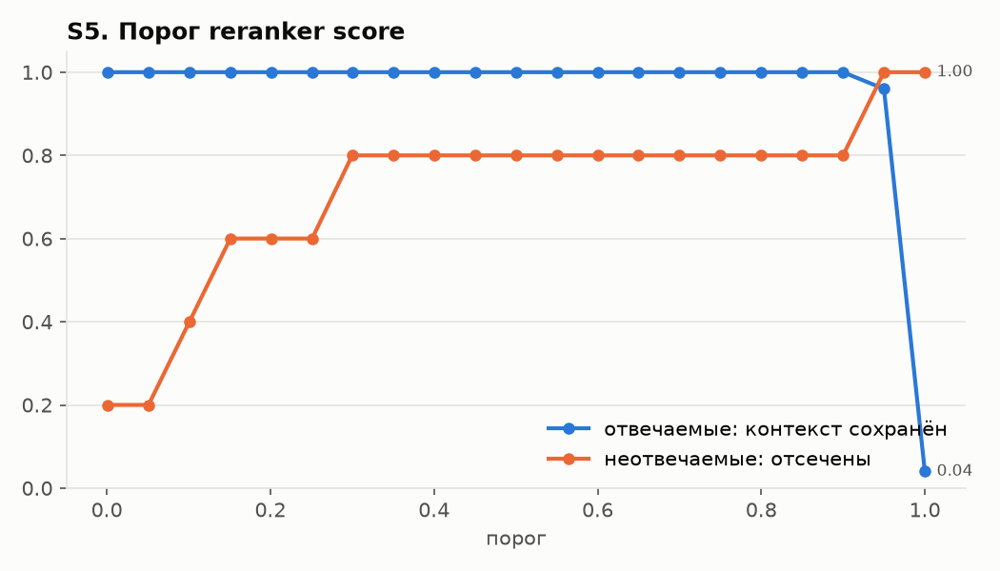
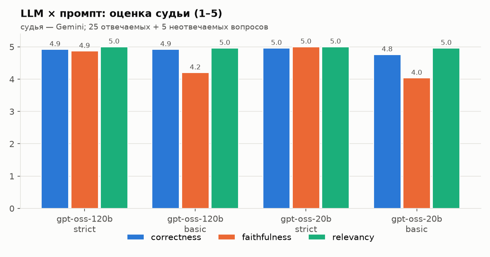
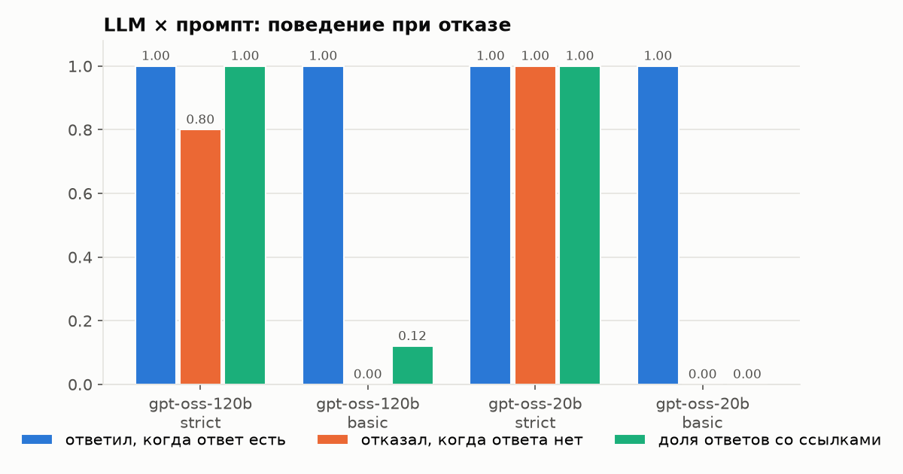

# Отчёт: RAG-система «Солнечная система»

Каждое решение описано по схеме: **что** → **почему** → **альтернативы** → **эксперимент** → **результат** → **выбор**.
Все цифры получены скриптами из `experiments/` и лежат в `experiments/results/*.csv`.

## 1. Постановка задачи

Система отвечает на вопросы о Солнечной системе (Солнце, планеты, спутники, малые тела,
космические миссии) только по собственной базе знаний и указывает источники; если ответа
в базе нет — сообщает об этом, а не выдумывает.

Окружение: RTX 5060 Ti 16 ГБ (CUDA 12.8), i5-14400F, 32 ГБ RAM, Windows 11, Python 3.13.

## 2. Сбор данных (grabber)

- **Что:** 112 статей русской Википедии, сгруппированных в 7 типов (`entity_type`):
  star 4, planet 12, dwarf_planet 6, moon 24, small_body 19, mission 36, science 11.
  Объём — 2,6 млн символов.
- **Почему Википедия и MediaWiki API:** авторитетный, структурированный (секции h2/h3, карточки)
  источник на русском; API отдаёт готовый HTML (`action=parse`) и дешёвую версию страницы (`lastrevid`).
- **Альтернативы:** парсинг HTML страниц (хрупко), дампы Википедии (избыточно), научно-популярные сайты (нет API, разная вёрстка).
- **Как устроено:**
  1. список статей задаётся в `configs/default.yaml` по группам;
  2. `prop=info` пачками по 50 → `pageid`, `lastrevid` (редиректы разрешаются автоматически);
  3. если `lastrevid` совпадает с манифестом и файл документа есть — статья **не скачивается** (`skipped`);
  4. иначе `action=parse` → сырой ответ сохраняется в `data/raw/` → парсер режет HTML на секции по h2/h3
     (h3 получает контекст: «Атмосфера и климат / Климат»), карточка (infobox) превращается в секцию
     «Характеристики» со строками «параметр | значение»;
  5. SHA-256 содержимого: не изменилось → `unchanged`; совпало с другим документом → `duplicate`;
     статьи, пропавшие из листинга, → `removed` (файл удаляется).
- **HTTP:** пауза 0,3 с между запросами, повторы с экспоненциальной задержкой на 429/5xx, уважение `Retry-After`,
  User-Agent с контактом (требование Википедии). Ошибка одной статьи не роняет прогон (`failed` в манифесте).
- **Проверка инкрементальности на практике:** после первого сбора (112 новых) три заголовка оказались
  неудачными (`Мессенджер` → редирект на статью о программах-мессенджерах, `DART` и `Dawn` — страницы неоднозначности).
  После исправления списка повторный `grab`: **skipped 109, new 3, removed 3** — скачаны только три новые статьи.

## 3. Предобработка и chunking

- **Очистка:** удаляются сноски `[1]`, навигационные шаблоны, плашки, галереи, формулы, служебные секции
  («Примечания», «Литература», «Ссылки», «См. также» и т. п.); Unicode-нормализация NFKC, кавычки и
  пробелы приводятся к единому виду, удаляются повторы длинных строк, склеиваются «осиротевшие» обрывки строк.
- **Metadata каждого chunk:** `doc_id`, `title`, `sections`, `url`, `source`, `lang`, `entity_type`,
  `updated_at`, `position`, `n_tokens`, `strategy` — хранятся в payload Qdrant, по ним работает фильтр
  (`retrieval.filters`, напр. `{entity_type: [planet, moon]}`).
- **Заголовок-контекст:** в начало chunk добавляется «Документ — Секция» (напр. «Марс — Спутники»):
  короткий фрагмент без него теряет, о каком объекте идёт речь.
- **Размер в токенах** считается токенизатором XLM-R — он общий у e5 и bge-m3, поэтому chunk гарантированно
  влезает в модель (лимит 512).

### Стратегии chunking

| Стратегия | Как работает |
|---|---|
| fixed | окно фиксированного размера по токенам, границы секций игнорируются |
| fixed + overlap | то же с перекрытием соседних окон |
| paragraph | абзацы жадно упаковываются до лимита, границы секций игнорируются |
| section | chunk не пересекает границу секции; длинная секция делится по абзацам/предложениям |

## 4. Датасет для оценки

30 вопросов (`data/eval/questions.jsonl`): 8 фактологических, 7 на конкретную информацию (числа, даты),
5 по нескольким документам, 5 на понимание контекста («почему…»), 5 без ответа в базе.
Эталон размечен на уровне **документ + секция** (а не конкретного chunk), поэтому один датасет годится
для любой стратегии chunking. Если факт продублирован (карточка и введение), секции перечисляются списком
как равноправные. Ссылки эталона проверяет скрипт `experiments/check_dataset.py`
(существует ли документ и секция) — все 30 вопросов проходят проверку.

**Метрики поиска:** Hit@K (есть ли релевантный chunk в top-K), Recall@K (доля эталонных пар
«документ+секция», покрытых top-K), Precision@K, MRR, nDCG@K. Считаются по 25 отвечаемым вопросам.

## 5. Эксперименты с поиском

Порядок последовательный: лучший вариант этапа фиксируется и используется дальше
(критерий — MRR, при равенстве Recall@5). Скрипт: `experiments/run_retrieval.py`.

### S1. Стратегия chunking

- **Почему важно:** слишком крупный chunk «размывает» вектор, слишком мелкий теряет контекст.
- **Эксперимент:** e5-small, dense-поиск, top-20 кандидатов без фильтров и reranker.

| chunking | Hit@1 | Hit@5 | MRR | Recall@5 | nDCG@5 | chunks | ср. токенов |
|---|---|---|---|---|---|---|---|
| fixed-256 | 0.76 | 0.92 | 0.811 | 0.90 | 0.638 | 2947 | 252 |
| fixed-256 + overlap 64 | 0.76 | 0.96 | 0.843 | 0.94 | 0.671 | 3872 | 254 |
| paragraph-256 | 0.76 | 0.96 | 0.825 | 0.94 | 0.601 | 3751 | 197 |
| **section-128** | **0.80** | **0.96** | **0.860** | **0.96** | 0.669 | 7824 | 93 |
| section-256 | 0.80 | 0.96 | 0.849 | 0.94 | 0.653 | 4054 | 180 |
| section-512 | 0.68 | 0.92 | 0.782 | 0.90 | 0.573 | 2299 | 318 |

- **Результат:** границы секций помогают — section-128/256 лучше fixed и paragraph того же размера;
  overlap 64 даёт +0,03 MRR к fixed-256 ценой +31 % chunks. Слишком большие chunks (512) хуже всех:
  в одном векторе смешиваются разные факты. Мелкие секционные chunks лучше всего подходят для
  фактологических вопросов (большинство вопросов датасета — про конкретное число или дату).
- **Выбор:** **section-128** (лучшие MRR и Recall@5). Минус — больше chunks (7824), но на GPU это секунды.

### S2. Embedding-модель

- **Альтернативы:** multilingual-e5-small (118M, 384 изм.) — быстрая; bge-m3 (568M, 1024 изм.) — крупная SOTA-модель.
- **Эксперимент:** лучший chunking из S1, dense, top-20.

| модель | Hit@1 | Hit@5 | MRR | Recall@5 | nDCG@5 | индексация, с |
|---|---|---|---|---|---|---|
| e5-small | 0.80 | 0.96 | 0.860 | 0.96 | 0.669 | 53 (вместе с chunking, S1) |
| **bge-m3** | **0.92** | 0.96 | **0.932** | 0.94 | **0.709** | 158 |

- **Результат:** bge-m3 заметно точнее на первой позиции (Hit@1 +0,12, MRR +0,07) и единственная
  находит релевантный chunk для всех вопросов в top-10. Индексация 7824 chunks на GPU — 2,5 мин (один раз,
  дальше векторы берутся из кэша), поиск одного запроса — 0,08 с.
- **Выбор:** **bge-m3**.

### S3. Top-K

Из того же прогона S2 (bge-m3):

| K | 1 | 3 | 5 | 10 | 20 |
|---|---|---|---|---|---|
| Hit@K | 0.92 | 0.92 | 0.96 | 1.00 | 1.00 |
| Recall@K | 0.82 | 0.88 | 0.94 | 0.98 | 0.98 |
| Precision@K | 0.92 | 0.67 | 0.59 | 0.48 | 0.37 |

- **Результат:** рост полноты останавливается на K = 10 (Recall 0,98), дальше растёт только шум
  (Precision падает). В LLM имеет смысл отдавать около 5 chunks: больше — длиннее промпт и больше
  нерелевантного текста.
- **Выбор:** достаём **10 кандидатов**, после reranker в LLM уходят **5**.

### S4. Reranker

- **Почему:** bi-encoder кодирует вопрос и chunk по отдельности; cross-encoder видит их вместе и
  точнее оценивает релевантность, но дороже — поэтому применяется только к top-10.
- **Эксперимент:** bge-m3 dense, 10 кандидатов → фильтры не применяются → top-5 (без reranker — первые 5
  по cosine; с reranker — 5 лучших по bge-reranker-v2-m3). Метрики на итоговых 5 chunks.

| вариант | Hit@1 | Hit@3 | Hit@5 | MRR | Recall@5 | nDCG@5 | поиск, с/вопрос |
|---|---|---|---|---|---|---|---|
| без reranker (top-5 по cosine) | **0.92** | 0.92 | 0.96 | **0.928** | 0.94 | **0.910** | 0.05 |
| **bge-reranker-v2-m3, 10 → 5** | 0.84 | 0.92 | **1.00** | 0.891 | **0.98** | 0.880 | 0.21 |

- **Результат:** reranker немного переставил порядок (Hit@1 0,92 → 0,84, MRR 0,93 → 0,89), но **поднял
  полноту итогового контекста**: Hit@5 0,96 → 1,00, Recall@5 0,94 → 0,98 — подтянул в пятёрку chunks
  с 6–10 мест. В LLM уходят все 5 фрагментов сразу, порядок внутри контекста для модели почти не важен,
  поэтому критерий выбора для этого этапа — Recall@5. Второй плюс — откалиброванный скор релевантности
  (см. S5), которого у cosine нет.
- **Выбор:** **bge-reranker-v2-m3, 10 → 5**. Цена — +0,16 с на вопрос на GPU.

### S5. Пороги отсечения (cosine и reranker)

- **Задача:** по максимальному скору понять, что в базе нет ответа, и отказать до вызова LLM.
- **Эксперимент:** без новых прогонов — по сохранённым скорам (`retrieval_s5_scores.csv`) для всех 30 вопросов
  перебирается порог; считается доля отвечаемых вопросов, у которых контекст сохранился, и доля
  неотвечаемых, которые отсечены.

| скор | отвечаемые: min / среднее | неотвечаемые: max / среднее |
|---|---|---|
| cosine (bge-m3) | 0.610 / 0.713 | 0.647 / 0.588 |
| reranker | 0.918 / 0.995 | 0.929 / 0.271 |

- **Результат:** у cosine распределения перекрываются: все значения сжаты в узкий диапазон 0,52–0,78,
  и лучший порог (0,649) держится на зазоре в 0,002 — на новых вопросах он ненадёжен.
  У reranker скоры разведены: у отвечаемых почти всегда > 0,99, у 4 из 5 неотвечаемых < 0,27.
  Любой порог 0,3–0,9 сохраняет все отвечаемые вопросы и отсекает 80 % неотвечаемых; порог 0,95 отсекает
  все неотвечаемые, но теряет один отвечаемый (q17, скор 0,918). Неотсекаемый вопрос q28
  («кто первым вышел в открытый космос») — тематически близкие chunks о пилотируемых полётах есть, но ответа нет.
- **Выбор:** cosine-порог не используется; порог reranker — параметр `reranker.min_score`. Оставшиеся
  неотвечаемые вопросы отсекает строгий промпт (раздел 6), поэтому в эксперименте с генерацией порог выключен,
  чтобы сравнить LLM и промпты в чистом виде; для интерфейса рекомендуемое значение — **0,3**
  (не теряет ни одного отвечаемого вопроса).

## 6. Генерация

- **Промпты** (`src/generation/prompts.py`):
  - **strict** — отвечать только по контексту, ссылка `[n]` после каждого утверждения, при отсутствии ответа —
    фиксированная фраза «В базе знаний недостаточно информации…», числа — точно как в контексте;
  - **basic** — «вот фрагменты, ответь на вопрос» без запрета собственных знаний и без требования ссылок.
- **LLM:** Groq, open-weight `openai/gpt-oss-120b` и `openai/gpt-oss-20b` (reasoning_effort=low, temperature 0).
- **Судья:** `gemini-3.5-flash-lite` (другое семейство моделей → меньше эффекта «хвалит свои ответы»), оценки 1–5:
  correctness (совпадение с эталоном), faithfulness (всё ли подтверждается контекстом), relevancy (по делу ли ответ).
  Отказы проверяются правилом: отвечаемый вопрос → отказа быть не должно, неотвечаемый → должен быть отказ.
- **Источники:** в ответ попадают только процитированные фрагменты `[n]` (документ, секция, URL).
- Ответы LLM кэшируются в SQLite — повторный прогон не тратит бесплатную квоту.

### Эксперимент: LLM × промпт

Retrieval — итоговый из раздела 5 (section-128, bge-m3, 10 → reranker → 5), порог reranker выключен,
чтобы сравнить именно LLM и промпты. 30 вопросов × 4 варианта, каждый ответ оценён судьёй.
Скрипт: `experiments/run_generation.py`; ответы и комментарии судьи — `results/generation_all.csv`.

| вариант | correctness | faithfulness | relevancy | ответил, когда ответ есть | отказал, когда ответа нет | ответов со ссылками | время ответа, с |
|---|---|---|---|---|---|---|---|
| gpt-oss-120b / strict | 4.92 | 4.87 | 5.00 | 25/25 | 4/5 | 100 % | 4.96 |
| gpt-oss-120b / basic | 4.92 | 4.20 | 4.96 | 25/25 | 0/5 | 12 % | 7.26 |
| **gpt-oss-20b / strict** | **4.96** | **5.00** | **5.00** | 25/25 | **5/5** | 100 % | **0.45** |
| gpt-oss-20b / basic | 4.76 | 4.03 | 4.96 | 25/25 | 0/5 | 0 % | 3.09 |

(correctness и relevancy — по 25 отвечаемым вопросам, faithfulness — по всем 30.)

- **Промпт важнее модели.** С basic-промптом обе модели **ни разу не отказали** на 5 вопросах без ответа в базе:
  они отвечают из собственных знаний (масса Стрельца A*, расстояние до Андромеды, цена билета Blue Origin),
  часть ответов выдумана («Спектр-УФ» запустят в 2024/2025 году с Байконура/Восточного). Кроме того, basic
  «дополняет» контекст: на вопрос о карликовых планетах 2006 года обе модели перечислили пять объектов вместо
  трёх (Хаумеа и Макемаке признаны позже), 20b перепутала дату выхода «Галилео» на орбиту с датой схода с неё.
  Ссылки `[n]` без требования в промпте почти не ставятся (0–12 %) — пользователь не может проверить ответ.
- **Strict-промпт** даёт ответы со ссылками в 100 % случаев и faithfulness ≈ 5. Единственная ошибка —
  gpt-oss-120b на q28 («кто первым вышел в открытый космос»): в контексте был фрагмент о полёте Гагарина,
  и модель ответила «Гагарин вышел в открытый космос» (на самом деле Леонов, 1965) — склейка факта
  из контекста с вопросом. gpt-oss-20b на этом вопросе корректно отказала.
- **Модели:** на отвечаемых вопросах качество практически одинаковое (разница — 1 оценка из 125),
  но 20b в ~10 раз быстрее (0,45 с против 5 с на Groq) и на этом датасете аккуратнее отказывает.
  Выборка неотвечаемых вопросов мала (5), поэтому различие 4/5 vs 5/5 — не статистически значимое,
  но вместе со скоростью решает выбор.
- **Связь с порогом S5:** q28 — тот самый неотвечаемый вопрос, который reranker оценил высоко (0,93).
  Порог отсекает остальные 4 неотвечаемых вопроса ещё до LLM, а для «трудных» случаев последний рубеж —
  строгий промпт.
- **Выбор:** **gpt-oss-20b + strict**, порог reranker 0,3.

## 7. Итоговая конфигурация

| Параметр | Значение |
|---|---|
| Chunking | section, 128 токенов, заголовок «Документ — Секция» |
| Embeddings | BAAI/bge-m3 |
| Vector DB | Qdrant (embedded), cosine |
| Поиск | dense, top-10 кандидатов |
| Фильтры | мин. длина 60 символов, дедупликация (Jaccard ≥ 0,85) |
| Reranker | BAAI/bge-reranker-v2-m3, 10 → 5, порог `min_score` (рекомендуется 0,3) |
| LLM / промпт | Groq `openai/gpt-oss-20b`, temperature 0, промпт strict |

## 8. Интерфейс

`streamlit run app.py`: поле вопроса, ответ со ссылками `[n]`, список источников (ссылки на статьи Википедии),
раскрывающийся список найденных фрагментов со скорами cosine и reranker, настройки (reranker вкл/выкл, промпт,
модель, Top-K), время этапов. CLI: `python -m src.cli ask "…" --show-context`.

## 9. Выводы и ограничения

- Система закрывает все 25 отвечаемых вопросов датасета (correctness 4,96 / 5) и отказывает на всех 5 вопросах
  без ответа в базе; каждое утверждение снабжено ссылкой на фрагмент и URL статьи.
- Больше всего на качество поиска повлияли **embedding-модель** (bge-m3: MRR 0,86 → 0,93) и **chunking по секциям**
  мелкого размера; reranker улучшает полноту итогового контекста (Recall@5 0,94 → 0,98) и даёт пригодный для
  отказа скор релевантности. На генерации решающим оказался **строгий промпт**: без него отказов нет совсем.
- **Ограничения:** датасет небольшой (30 вопросов, 5 неотвечаемых) — различия в сотые доли метрик
  находятся в пределах шума; судья — тоже LLM и может ошибаться; корпус — 112 статей, вопросы о
  смежных темах (космонавтика, далёкий космос) уходят в отказ; эталон размечен вручную одним человеком.
- **Что улучшить:** расширить датасет и корпус, проверить hybrid-поиск (BM25 + dense, уже реализован —
  `retrieval.mode: hybrid`) на вопросах с точными названиями и числами, добавить проверку цитат
  (каждое утверждение ↔ фрагмент) вторым проходом LLM.
